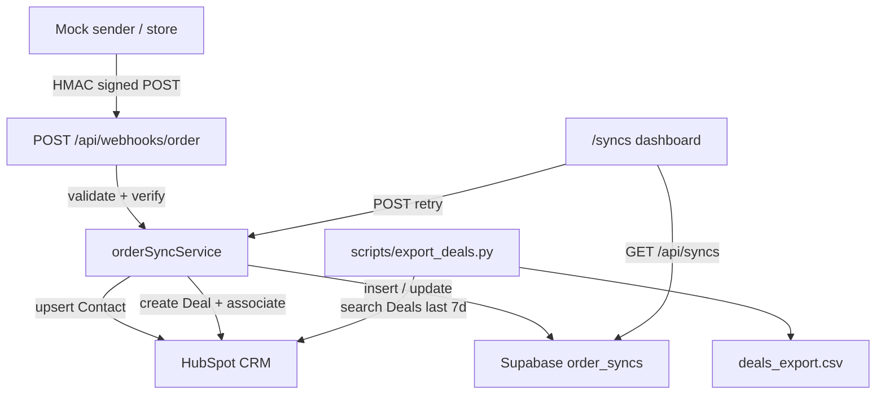

# HubSpot Order Sync — Stage 2 Take-home

A full-stack integration that receives store `order.created` webhooks, syncs Contacts and Deals into HubSpot, persists sync attempts in Supabase, and exposes a dashboard with retry. Includes a standalone Python CSV exporter for recent Deals.

---

## Requirements addressed

| # | Requirement | Implementation |
|---|---|---|
| 22 | Webhook receiver + HMAC | `POST /api/webhooks/order` |
| 23 | HubSpot Contact + Deal sync | `server/services/orderSyncService.ts` |
| 24 | Idempotency by `order_id` | Unique constraint on `order_syncs.order_id` |
| 25 | Retry / backoff / failure logging | `server/lib/retry.ts` + `order_syncs` |
| 26 | Database persistence | Supabase PostgreSQL (`order_syncs`) |
| 27 | Sync dashboard + Retry | `/syncs` |
| 28 | Second language (Python) | `scripts/export_deals.py` |
| 29 | README | This file |

Also includes a contacts CRUD dashboard (list / create / edit) built earlier as supporting infrastructure.

---

## Architecture



Lightweight Feature-Sliced Design:

- `app/` — routes and Route Handlers
- `views/` — page composition
- `widgets/` — SyncTable, ContactsTable
- `features/` — create/edit contact, retry sync
- `entities/` — Contact and Order types + Zod schemas
- `shared/` — UI primitives and API helpers
- `server/` — HubSpot, Supabase, webhook verify, retry (server-only)

---

## Prerequisites

- Node.js ≥ 20.9
- npm ≥ 11
- Python 3.10+ (for the exporter)
- HubSpot **developer test account** (not production)
- Supabase project (free tier is fine)

---

## Installation

```bash
npm install

cd scripts
python -m pip install -r requirements.txt
cd ..
```

Copy environment template:

```bash
cp .env.example .env.local
```

Fill in real values in `.env.local` (never commit this file).

---

## Environment variables

| Variable | Purpose | Exposure |
|---|---|---|
| `HUBSPOT_PRIVATE_APP_TOKEN` | Private App access token | Server-only |
| `HUBSPOT_DEAL_PIPELINE_ID` | Deal pipeline ID | Server-only |
| `HUBSPOT_DEAL_STAGE_ID` | Deal stage ID | Server-only |
| `WEBHOOK_SIGNING_SECRET` | HMAC shared secret | Server-only |
| `WEBHOOK_URL` | Optional mock sender target | Local only |
| `NEXT_PUBLIC_SUPABASE_URL` | Supabase project URL | Public |
| `NEXT_PUBLIC_SUPABASE_ANON_KEY` | Supabase anon key | Public |
| `SUPABASE_SERVICE_ROLE_KEY` | Service-role key (bypasses RLS) | Server-only |

---

## HubSpot setup

1. Create a [HubSpot developer test account](https://developers.hubspot.com).
2. Create a **Private App** with scopes:
   - `crm.objects.contacts.read`
   - `crm.objects.contacts.write`
   - `crm.objects.deals.read`
   - `crm.objects.deals.write`
3. Copy the access token into `HUBSPOT_PRIVATE_APP_TOKEN`.
4. Find pipeline / stage IDs: **Settings → Objects → Deals → Pipelines**, or call `GET /crm/v3/pipelines/deals`.
5. Set `HUBSPOT_DEAL_PIPELINE_ID` and `HUBSPOT_DEAL_STAGE_ID`.

Defaults (`default` / `appointmentscheduled`) work on many test portals but are not guaranteed.

---

## Database setup

Run both migrations in the Supabase **SQL Editor**:

1. [`supabase/migrations/001_contacts.sql`](supabase/migrations/001_contacts.sql) — contacts cache
2. [`supabase/migrations/002_order_syncs.sql`](supabase/migrations/002_order_syncs.sql) — order sync attempts

Verify: Table Editor shows `contacts` and `order_syncs`. RLS is enabled; no anon policies. All writes use the service-role key from the Next.js server.

---

## Webhook signing and mock sender

Assumption (not named in the assessment brief):

- Header: `x-webhook-signature`
- Algorithm: HMAC-SHA256 over the exact raw UTF-8 body
- Encoding: lowercase hex
- Comparison: constant-time (`crypto.timingSafeEqual`)

Generate a secret:

```bash
openssl rand -hex 32
```

Put it in `WEBHOOK_SIGNING_SECRET`, then:

```bash
npm run dev
# in another terminal:
npm run send-webhook
# or with a fixed order id (positional — not --order-id):
npm run send-webhook -- ORD-10482
# optional: new Contact (not Maria)
npm run send-webhook -- --unique-email
npm run send-webhook -- --email johndoe+demo@gmail.com
```

Expected: HTTP 200, Contact + Deal in HubSpot, row on `/syncs`. Default customer is Maria; `--unique-email` / `--email` create a distinct Contact.

Send the same `order_id` again after **success** → HTTP 200 `"alreadySeen": true`, still **one** Deal.

Redelivery of a `failed` or stuck `processing` row **re-runs** the sync (idempotent Deal recovery by name) instead of ignoring the webhook.

---

## Docker (app only)

Runs the Next.js app in a container on port **3000**. **Does not** start Supabase or HubSpot — use your existing cloud project and Private App credentials in `.env.local` (migrations must already be applied in Supabase).

1. Install [Docker Desktop](https://www.docker.com/products/docker-desktop/) (or Docker Engine + Compose).
2. Copy and fill env (same as local dev):

   ```bash
   cp .env.example .env.local
   ```

3. Compose uses `${NEXT_PUBLIC_*}` from a root `.env` file for **image build** args. Either copy once:

   ```bash
   cp .env.local .env
   ```

   or export those two variables in your shell before `docker compose build`.

4. Build and run:

   ```bash
   docker compose build
   docker compose up
   ```

5. Open http://localhost:3000 (`/contacts`, `/syncs`).

**Webhook sender from the host** (container publishes `3000:3000`):

```bash
# In .env.local on the machine running the sender (optional; default is localhost:3000)
WEBHOOK_URL=http://localhost:3000/api/webhooks/order
npm run send-webhook -- ORD-DOCKER-1
```

Server-only secrets (`SUPABASE_SERVICE_ROLE_KEY`, `HUBSPOT_PRIVATE_APP_TOKEN`, `WEBHOOK_SIGNING_SECRET`, etc.) are loaded at **runtime** via `env_file: .env.local` — not baked into the image. Do not commit `.env` / `.env.local`.

---

## How to run

| Command | Purpose |
|---|---|
| `npm run dev` | Next.js app at http://localhost:3000 |
| `docker compose up` | Production app in Docker (see above) |
| `npm run send-webhook` | Signed mock order webhook |
| `npm test` | Vitest unit tests |
| `npm run test:python` | Python exporter unit tests (mocked API) |
| `npm run lint` | ESLint |
| `npm run type-check` | TypeScript |
| `npm run build` | Production build |
| `python scripts/export_deals.py` | Export last 7 days of Deals to CSV |
| `python scripts/export_deals.py --dry-run` | Preview without writing a file |
| `python scripts/test_export_deals.py` | Same as `npm run test:python` |

Pages:

- `/contacts` — HubSpot contacts list (5 per page; search `?q=`; add/edit modals; optional `?add=1` or `?edit=<hubspotId>`; cursor `?after=` + `history`; Previous / Next)
- `/contacts/[id]/edit` — redirects to `/contacts?edit=<id>` (opens edit modal)
- `/syncs` — order sync dashboard from Supabase (5 per page; `?page=` + optional `?q=` order ID; Previous / Next)

---

## Example webhook payload

```json
{
  "event": "order.created",
  "order_id": "ORD-10482",
  "created_at": "2026-09-20T14:32:00+08:00",
  "customer": {
    "email": "maria.santos@example.com",
    "first_name": "Maria",
    "last_name": "Santos",
    "phone": "+639171234567"
  },
  "items": [
    { "sku": "TSH-BLK-M", "name": "Black Tee (M)", "qty": 2, "price": 450.0 }
  ],
  "currency": "PHP",
  "total": 900.0
}
```

Flow:

1. Verify HMAC → reject 401 if invalid (no HubSpot call).
2. Validate Zod schema → reject 400 if invalid.
3. Insert `order_id` uniquely → if conflict, return 200 duplicate.
4. Upsert Contact by email; create Deal `Order {order_id}`; associate; persist IDs.
5. On HubSpot 429/5xx: bounded exponential backoff (max 4 attempts). Permanent 4xx is not retried.
6. Failures stored in `order_syncs` for dashboard Retry.

---

## Idempotency, retry, and dashboard

- **Idempotency:** PostgreSQL `UNIQUE (order_id)`. Concurrent duplicates lose the insert race safely. Successful syncs stay `alreadySeen` on redelivery.
- **Resume:** Redelivery of `failed` or `processing` rows claims the row and re-runs HubSpot sync (uses stored payload when valid).
- **Partial recovery:** If Contact ID was saved but Deal was not, retry searches for deal name `Order {order_id}` before creating; after a failed create it searches again before giving up.
- **Retry button:** Enabled for `failed` and stuck `processing` rows. Server claims only those statuses (409 for `success` / `pending`).
- **Logging:** `status`, `error_message`, `attempt_count`, HubSpot IDs, timestamps.

---

## Python CSV exporter

```bash
cd scripts
python -m pip install -r requirements.txt
HUBSPOT_PRIVATE_APP_TOKEN=your_token python export_deals.py
```

- Window: last 7 days, **UTC**, filter on HubSpot `createdate`
- Pagination: follows HubSpot `after` until exhausted
- Columns: `deal_id`, `deal_name`, `amount`, `currency`, `created_at_utc`, `pipeline`, `stage`, `order_id`
- `currency` from HubSpot `deal_currency_code` when present (empty if the portal does not expose it)
- `order_id` parsed from deal name `Order …` when present

---

## Assumptions

- HMAC header / algorithm as documented above (brief did not specify).
- Deal name format: `Order {order_id}`.
- Close date: UTC date from `created_at`.
- Pipeline / stage from env (portal-specific).
- Currency on Deal create uses the portal default; payload currency is validated but not written as a Deal property. The Python exporter reads `deal_currency_code` when HubSpot returns it.
- Webhook handler returns 200 after accepting work so senders do not hammer retries; failures are recoverable via `/syncs`.

---

## Known limitations / future improvements

- No async job queue (retries are synchronous with short backoff).
- Dashboard has no authentication (assessment scope).
- No HubSpot-native webhook subscription (mock sender + shared secret instead).
- PHP currency may need enabling in HubSpot account defaults.
- With more time: BullMQ (or similar), webhook timestamp skew checks, n8n bonus workflow.

---

## Security notes

- Never commit `.env.local` or real tokens.
- `server/` modules use `import "server-only"`.
- Service-role and webhook secret are never sent to the browser.
- Do not log secrets or paste them into chat / README.
